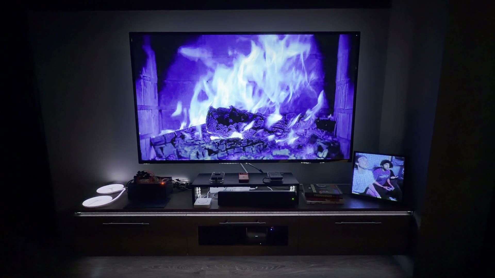

<p align="center">
  
</p>

# Prism

Prism turns a song into a light show. It splits the song into its instruments with machine-learning models, measures how each one changes over time, and lets you connect those measurements to LED lights that play in sync with the music.

[](docs/images/demo.mp4)

_A Prism show for "Ne Plus Ultra" on TV and shelf LED strips. Click to play with sound._


## How it works

1. **Import** an audio file or a YouTube link.
2. **Separate** the song into stems (vocals, drums, bass, and the rest) with neural source-separation models.
3. **Analyze** the full mix and every stem. Prism measures more than 50 features at 100 frames per second: loudness, brightness, beats, chords, key, song sections, pitch, the type of sound, and more.
4. **Map** features to light. A program turns a feature into color, brightness, or motion, for example bass energy driving a strip's brightness.
5. **Play** the show on WLED/ESP32 LED strips, synced to the audio.

## Models

| Task              | Model                                                      | Output                                                           |
| ----------------- | ---------------------------------------------------------- | ---------------------------------------------------------------- |
| Stem separation   | Demucs `htdemucs_ft` (hybrid transformer)                  | vocals, drums, bass, other                                       |
|                   | Demucs `htdemucs_6s`                                       | adds guitar, piano                                               |
|                   | BS-RoFormer, Mel-Band RoFormer                             | vocals, instrumental                                             |
| Drum separation   | MDX23C DrumSep                                             | kick, snare, toms, hi-hat, ride, crash                           |
| Chord recognition | BTC (bi-directional transformer, ISMIR 2019)               | chord changes from a 170-chord vocabulary                        |
| Sound tagging     | PANNs Cnn14, trained on AudioSet                           | per-frame probability of sound classes (e.g. singing, synth)     |
| Pitch             | pYIN                                                       | pitch contour and confidence per melodic stem; vibrato on vocals |
| Song sections     | self-similarity matrix, Foote novelty, spectral clustering | intro, verse, chorus, drop, breakdown, outro                     |
| Key               | Krumhansl-Schmuckler key profiles                          | key and confidence                                               |

Separation engines are selectable, and every stem from every engine gets the same feature pass, so engines can be compared side by side. Models run locally on the Mac GPU (PyTorch MPS). Full feature list: [`docs/feature-catalog.md`](docs/feature-catalog.md).

## The app

### Analysis

Every feature as a graph, aligned to a waveform you can play, scrub, and slow down. Solo any stem to hear what a graph is measuring. Each graph has an onset lane marking its peaks. Star features to use them in Mapping.


### Mapping

A program binds a feature to a light channel through a chain of transforms: normalize, smooth, envelope, color map, label-to-value, and motion (chase, sweep, pulse). Programs are evaluated live, each with a preview lane over the whole song and a live light preview. **Generate** proposes starter programs from starred features, and song sections can switch scenes.


### Hardware

Finds WLED/ESP32 hubs on the network, lists each hub's lights, and patches programs onto lights (click a program, then a light). Frames stream over DDP during playback, with an adjustable light delay to line the lights up with the audio.


### Companion

Prism can connect to a [prism-player](https://github.com/riverray121/prism-player) server, which plays finished shows without the Mac. Prism publishes a show as a bundle (audio plus 40 Hz RGB frames per light) and imports songs the server requests. In automatic mode it imports, analyzes, maps, and publishes requested songs with no input.

## Built with

Tauri desktop app: Svelte UI, Rust shell, Python analysis process (librosa, PyTorch, audio-separator).

## Run it

Requires Rust, Node + pnpm, uv, and ffmpeg.

```sh
pnpm install
uv sync
pnpm tauri dev
```

Tests: `uv run pytest` and `pnpm test`. Design docs: [`docs/index.md`](docs/index.md).
