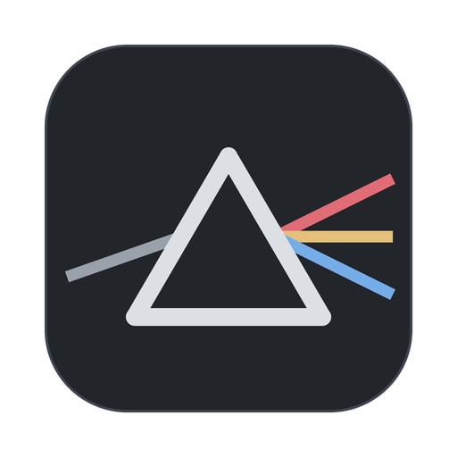
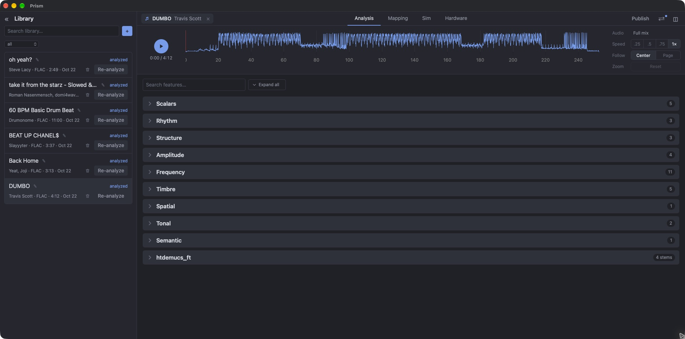
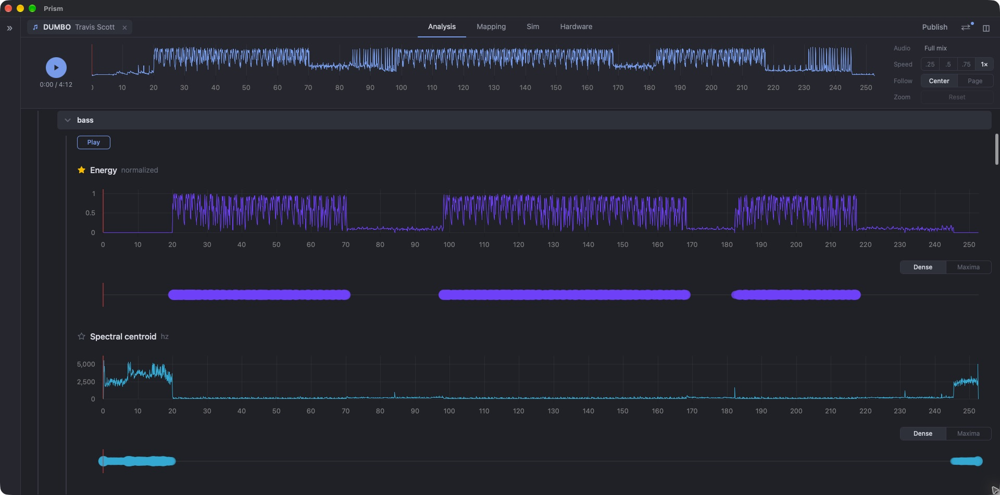
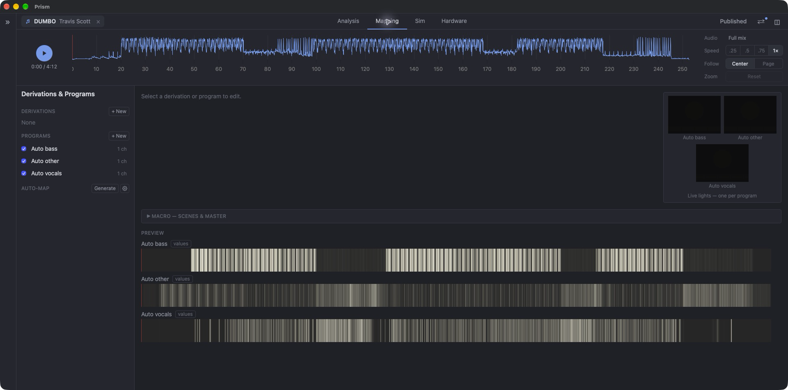
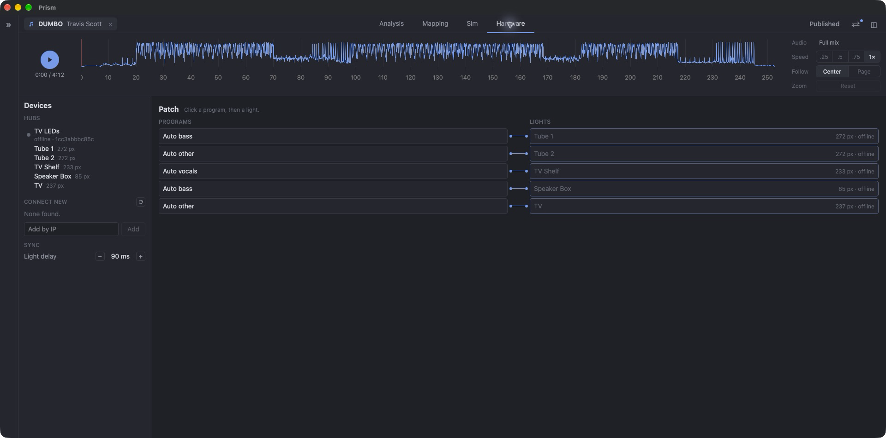
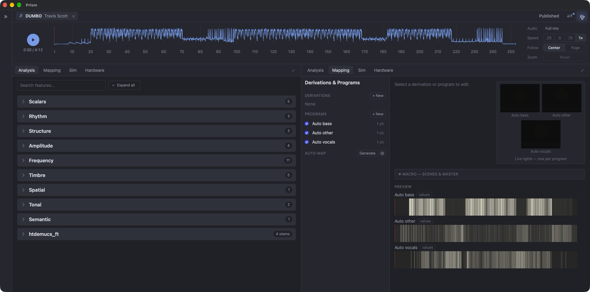

<p align="center">
  
</p>

# Prism

A Mac desktop app that analyzes songs and turns them into light shows. Prism separates each track into stems, extracts a full set of musical features (DSP and ML), shows them against synced playback, maps them to light programs, and streams the result to WLED/ESP32 LED hubs.

Built with Tauri 2 (Rust shell), Svelte 5, and a Python analysis sidecar.



## Features

### Library

- Import audio files or YouTube URLs (yt-dlp + ffmpeg).
- Search, filter by status (`unanalyzed`, `queued`, `analyzing`, `analyzed`, `failed`), edit title and artist, re-analyze, delete.
- Background analysis queue. Each song stores a `profile.json` plus `.npy` arrays and stem WAVs.

### Analysis



- **Stem separation** through `audio-separator`, with selectable engines: Demucs `htdemucs_ft` (vocals/drums/bass/other), Demucs `htdemucs_6s` (adds guitar/piano), BS-RoFormer, Mel-Band RoFormer. Optional drum sub-separation.
- **Mix-level features**: BPM, beats, downbeats, rhythmic density, spectral centroid/flux/flatness/rolloff, six band energies, RMS, peak, LUFS, dynamic range, key, chords, chroma, tuning, MFCC, zero-crossing rate, stereo width, sections, novelty, PANNs sound tags.
- **Per-stem features** for every stem of every engine: energy, onsets, transient sharpness, centroid, MFCC, pitch (pYIN) for melodic stems, vibrato for vocals.
- Graphs grouped by category, time-aligned to a waveform transport with play, speed (0.25x to 1x), follow mode, zoom, and audio source (full mix or any stem).
- Feature search and favorites (star) that feed the Mapping tab.

Full list: [`docs/feature-catalog.md`](docs/feature-catalog.md).

### Mapping



- **Derivations**: saved signals built from analyzed features.
- **Programs**: fixture-agnostic light programs, each a transform chain over features or derivations, evaluated live in the frontend.
- **Auto-map**: generates programs from favorited features on demand.
- **Macro layer**: scenes from song sections and an adaptive master level.
- **Preview**: one lit-ribbon lane per program over the song timeline, plus a live light preview per program.

### Hardware



- Discovers WLED/ESP32 hubs over mDNS, or adds them by IP.
- Rig of hubs and named lights, with segment config read from the hub.
- Per-song patch: click a program, then a light.
- Streams frames over DDP synced to playback, from any tab. Light delay calibration in ms. Lights restore their prior state when playback stops.

### Companion

- Connects to one companion server ([`prism-player`](https://github.com/riverray121/prism-player)) by URL and token.
- **Requested queue**: songs the server asks Prism to import.
- **Publish**: exports a patched song as a show bundle (audio, 40 Hz RGB frames per light, project files).
- **Pull**: loads a published show back for editing.
- **Automatic mode**: imports, analyzes, auto-maps, patches, and publishes requests with no user input.

Contract: [`docs/companion-api.md`](docs/companion-api.md).

### Split view



Two panes, each with its own tab, sharing one transport.

## Architecture

```
Svelte UI  ──Tauri IPC──  Rust shell  ──JSON lines (stdin/stdout)──  Python sidecar
   │                         │                                         │
   graphs, mapping,          window, sidecar process,                  import, separation,
   live evaluation           mDNS, DDP streaming                       features, library.db
```

- Rust spawns the sidecar at launch and owns the window and network I/O.
- The sidecar runs librosa, torch (MPS), PANNs, and audio-separator, and writes to `library/`.
- Profile format: [`docs/profile-schema.md`](docs/profile-schema.md).

## Getting started

Prerequisites: Rust, Node + pnpm, uv, ffmpeg (`brew install ffmpeg`).

```sh
pnpm install        # frontend deps
uv sync             # Python sidecar env (Python 3.12)
pnpm tauri dev      # run the app
```

Release build: `pnpm tauri build --bundles app`.

## Development

| Task      | Command                                         |
| --------- | ----------------------------------------------- |
| Test      | `uv run pytest` · `pnpm test`                   |
| Lint      | `uvx ruff check sidecar/` · `pnpm format:check` |
| Typecheck | `pnpm check`                                    |

## Documentation

Design docs live in [`docs/`](docs/), organized by milestone. Start with [`docs/index.md`](docs/index.md).
